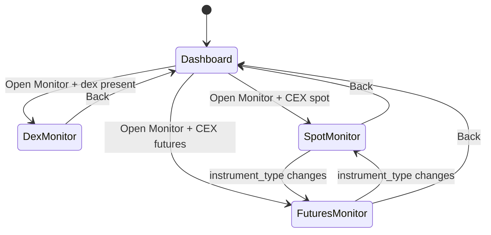

# Architecture

## Overview

This UI is a **thin gRPC client**. It does not read `bot.json`, talk to exchanges, MongoDB, or Redis. All data and commands go through `TradingCliService` on the trading runner.

```
┌─────────────────────────────────────────────────────────────┐
│  trading-system-ui (browser)                                 │
│  React · Zustand · TanStack Query · Connect RPC (gRPC-Web)  │
└────────────────────────────┬────────────────────────────────┘
                             │ HTTP (gRPC-Web)
                             ▼
┌─────────────────────────────────────────────────────────────┐
│  Envoy proxy (:8081)                                         │
│  grpc_web filter → native gRPC                               │
└────────────────────────────┬────────────────────────────────┘
                             │ HTTP/2 gRPC
                             ▼
┌─────────────────────────────────────────────────────────────┐
│  Trading runner (:50051)                                     │
│  TradingCliServiceImpl                                       │
└────────────────────────────┬────────────────────────────────┘
                             │
         exchange │ market_data │ indicator │ trading engines
```

## Repository layout

```
trading-system-ui/
├── proto/              # trading_cli.proto (sync from backend)
├── src/gen/            # Buf-generated types + Connect client
├── src/api/            # RPC wrappers, display transforms
├── src/hooks/          # Stream, levels poll, monitor actions
├── src/store/          # Zustand UI state
├── src/screens/        # MainMenu, SpotMonitor, FuturesMonitor, DexMonitor
├── src/components/     # Panels, dialogs, layout
├── docker/             # Envoy gRPC-Web compose + envoy.yaml
└── scripts/            # free-port helper
```

## State model

| State | Source | Update strategy |
|-------|--------|-----------------|
| `tradingEnabled` | `GetTradingStatus` | On connect, after global toggle |
| `monitoringData` | `StreamMonitoringData` | Replace full snapshot ~1 Hz |
| `levels` | `GetLevels` | On monitor enter, 5s poll (spot + futures), after mutations |
| `screen` | `monitoringData` | `main` / `spot` / `futures` / `dex` |
| `mode` | derived | `dex` when `monitoringData.dex` present; else `strategies` if `strategies.length > 0`, else `levels` |

## Screens



### Spot layout

- Left: Orders, Balances, Levels or Strategies
- Center: Orderbook (pair tabs)
- Right: Indicators, Aggregated (web-only)
- Bottom: Recent trades

### DEX layout (`DexMonitor`)

When `monitoringData.dex` is set (runner `--mode dex`), the UI opens a dedicated full-screen monitor instead of embedding DEX in CEX sidebars.

- Left: Venue info, pool-filtered DEX indicators, open orders
- Center: Orderbook (pair tabs drive pool filter)
- Right: Venue balances, pending transactions
- Bottom: Quotes, strategies (if any), recent trades
- Toolbar: toggle quote, toggle strategy, cancel pool orders

Pool scoping matches the TUI: orderbook tab label filters quotes, strategies, indicators, and open orders via `matchesPool()` in `src/lib/dexPool.ts`.

### Futures layout

- Levels mode: Positions, Levels, Orders | Orderbook | Margin, Indicators
- Strategies mode: Strategies, Orders | Orderbook | Margin, Indicators

## Display rules

Replicated from the Rust TUI (`cli/src/screens/shared/panels.rs`):

- Level enabled: green ✓ if enabled + global on; yellow ⏸ if enabled + global off; red ✗ if disabled
- PnL coloring: red if negative prefix, green otherwise
- Trades: newest first (reversed before display)
- Create/update: wrap price/qty as `Fixed(value)` for the server
- DEX: asset label resolution, `resolvedPrice || price` for quotes, truncated signatures/order ids

## Known limitations

- `DeleteLevel` RPC returns `UNIMPLEMENTED` on the server
- Runner gRPC port is hardcoded at `50051`
- Browser requires gRPC-Web proxy (cannot use native gRPC directly)
